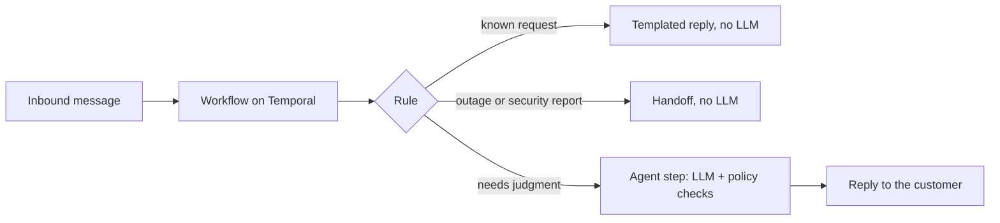

# hermes-one

Hermes is a platform for running customer conversations as workflows. Rules handle the messages
they can, and an LLM only runs when a message needs it.

Each inbound message (SMS today) starts a [Temporal](https://temporal.io) workflow. A rule looks at
the message and picks a route. Known requests get a templated reply, urgent ones get a notice and are
marked for a person to take over, and anything else goes to an agent step that calls the LLM under policy checks. It's multi-tenant,
and each business vertical is a JSON file instead of code.

The name stands for Hermes Orchestration Node Engine.



## Why build it this way

Most support and intake messages are repetitive. If a rule can answer a message, it never touches
a model, so it costs no tokens and gives the same answer every time. In the
support pack that ships with this repo, four of the five routes (password reset, billing, account
questions, escalation) never call an LLM.

When the agent does run, the model only suggests what to do. The platform checks every tool call
against the tenant's policy before running it, and checks the reply before it goes out. Side
effects carry idempotency keys, and each agent turn's tool calls, evidence, and policy decisions
are saved, so you can audit what happened.

Tenants are isolated in PostgreSQL with row-level security on every table with a
`tenant_id` column.
A tenant can plug in its own vendors and its own credentials without a deploy.

You can use any LLM. The model client speaks the OpenAI-compatible API, so OpenAI, Ollama, vLLM,
LM Studio, llama.cpp, or a gateway all work.

## What a vertical looks like

A vertical is a `pack.json` with a workflow, rules, a policy, and an agent setup. You install it
through the admin API by putting each definition and publishing a deployment. Here's the routing part of the support pack (`verticals/support/pack.json`,
reply text shortened):

```json
"triage": {
  "kind": "rule",
  "rule": {"definitionId": "def_support_triage", "version": "1.0.0"},
  "facts": {"text": {"$input": "text"}},
  "routes": {
    "escalate": "escalation_notice",
    "password-reset": "password_reset",
    "billing": "billing",
    "account-faq": "account_faq",
    "default": "assist"
  }
},
"password_reset": {
  "kind": "capability",
  "capability": "messaging.reply.send",
  "input": {"to": {"$input": "from"}, "template": "support_password_reset", "body": "To reset your password, …"},
  "next": "end"
},
"assist": {
  "kind": "agent",
  "agentEngine": {"definitionId": "def_support_engine", "version": "1.0.0"},
  "objective": "Answer the customer's support question plainly and accurately, …",
  "deliverReply": {"capability": "messaging.reply.send", "input": {"to": {"$input": "from"}, "template": "support_agent_reply", "body": {"$agent": "reply"}}},
  "next": "end"
}
```

Two verticals ship in `verticals/`: a residential electrician and support-ticket triage.

## Status

Pre-1.0. The core runs end to end and has unit, integration, replay, and end-to-end tests.
Interfaces can still change between minor versions. What's planned but not built is in the
[Roadmap](#roadmap). Open work is tracked in `docs/DEFERRED-AND-FLAGGED.md`, and the limits you
should know about before deploying are in `SECURITY.md`.

## What's in it

### Verticals as data

The electrician pack installs through the admin API (`apps/admin-api/src/pack-e.itest.ts`). In its
end-to-end run (`apps/agent-worker/src/pack-e.e2e.ts`), the model calls `appointment.slot.read`,
the platform picks the tenant's provider, and the call is recorded.

### Bring your own vendor

Each tenant can rank its own provider first and store its own credentials, encrypted per tenant.
`rotate()` replaces a tenant's credentials in one call. The electrician end-to-end run stores a
tenant's credentials with `rotate()` and checks that the agent's tool call uses them.

### Admin API

API-key and OIDC auth, with tenant-scoped routes for tenants, users, roles, definitions,
deployments (author, preview, publish, roll back), and provider mappings. There's no admin UI yet.

### Consistent records

Turn records, audit events, usage, and outgoing events are written in one tenant-scoped
transaction. Audit events are append-only and each one carries an integrity hash, so rewriting an
existing event is refused.

### A replay check in CI

There's one workflow interpreter. Every build replays recorded workflow histories against it and
fails if anything behaves differently. The recorded histories cover the rule-only workflow today;
agent workflow histories are on the roadmap.

### Observability

OpenTelemetry trace context carried across the Temporal boundary, with spans for the webhook
request, the agent turn, and each tool call, and logs for agent turns with PII masked. There's also an eval check the publish pipeline can run
before a deployment goes live; the demo publish path uses it, but the admin API's publish doesn't
call it yet. Cost and scalability analytics exist as components but aren't wired into an app yet.

## How it's built

There are two halves that never share runtime state. The edge (webhook gateway, admin API,
workflow and activity workers) runs on LoopBack 4. The agent side runs on
[agentback](https://github.com/ninemindai/agentback), a framework from the creator of LoopBack. They only talk through serialized data (Temporal activity inputs and
outputs, Postgres, HTTP), and `pnpm plane-lint` fails if edge code imports agentback, or agent code
imports LoopBack, at runtime.

Everything you configure (workflows, rules, policies, agent engines) is a versioned, content-hashed
definition validated with Zod. A running workflow stays pinned to the deployment version it started
on. Every dependency sits behind an interface, and the real implementations are wired in at each
app's entry point.

The reasoning behind these choices is in `docs/WHY-THIS-ARCHITECTURE.md`, and the decisions are
recorded in `docs/adr/`.

## Layout

| Folder            | What's there                                                 |
| ----------------- | ------------------------------------------------------------ |
| `apps/`           | the processes you run (workers, webhook gateway, admin API)  |
| `packages/`       | pure libraries: schemas, compilers, plan types               |
| `components/`     | the engines, wired through dependency injection              |
| `infrastructure/` | adapters for Postgres, Redis, Temporal, the LLM, and secrets |
| `verticals/`      | the vertical packs (data, not code)                          |
| `infra/`          | the local Docker Compose stack                               |
| `tools/`          | repo tooling (`plane-lint`)                                  |

All packages use the `@hermes-one/*` scope.

## Stack

TypeScript 5.7 (ESM), Node 22.13+, pnpm 11, Zod, Vitest, Temporal, PostgreSQL, Redis, and
OpenTelemetry. The local stack also runs Qdrant, which is reserved for knowledge retrieval (not
built yet).

## Running it

```bash
pnpm install
docker compose -f infra/docker-compose.yml up -d   # Temporal, Postgres, Redis, Qdrant, OTel collector
cp .env.example .env                              # defaults match the local stack

pnpm -r build      # build first: tests import other packages from their dist/
pnpm verify        # typecheck, plane-lint, unit tests
pnpm test:itest    # integration tests against the local stack
pnpm -F @hermes-one/workflow-worker replay-gate   # replay recorded workflow histories

node apps/workflow-worker/dist/e2e.js   # missed-call workflow on Temporal (no LLM)
node apps/api-gateway/dist/e2e.js       # signed webhook into a workflow (no LLM)
```

The agent tests need a model. To run them without one, use the scripted mock model that CI uses.
Load `.env` first, then point the LLM settings at the mock:

```bash
set -a; . ./.env; set +a
pnpm mock-llm &   # a fake OpenAI-compatible model on 127.0.0.1:4010
export LLM_BASE_URL=http://127.0.0.1:4010/v1 LLM_MODEL=mock LLM_API_KEY=mock
```

To use a real model instead, set the LLM settings in `.env` (see
[LLM configuration](#llm-configuration)) and skip the mock lines. Then:

```bash
node apps/agent-worker/dist/e2e.js                # rule routing: one message to the agent, one to a templated reply, one ignored
node apps/agent-worker/dist/support-pack.e2e.js   # support pack: rule replies, escalation, agent

# the electrician pack also needs HERMES_CREDENTIALS_MASTER_KEY in .env (64 hex characters, for
# example from `openssl rand -hex 32`), because it reads the tenant's own encrypted credentials
node apps/agent-worker/dist/pack-e.e2e.js
```

The mock gives fixed answers, so it tests the platform (routing, tool calls, policy checks,
storage, reply delivery), not how good a model's answers are.

## LLM configuration

Set three variables in `.env`. Any OpenAI-compatible endpoint works. `.env.example` starts out
pointed at a local llama-server on `127.0.0.1:8080/v1`:

```bash
# OpenAI
LLM_BASE_URL=https://api.openai.com/v1
LLM_MODEL=<model name>
LLM_API_KEY=<your key>

# Local: Ollama, llama.cpp (llama-server), vLLM, LM Studio, or any OpenAI-compatible server
LLM_BASE_URL=http://127.0.0.1:11434/v1   # Ollama's default; llama-server uses :8080/v1
LLM_MODEL=<model name>
LLM_API_KEY=local
```

The model needs tool calling for the agent flows. For a provider with a different API, add a
`SingleStepModel` adapter in `infrastructure/model-client`.

## How we work on it

Anything left unfinished on purpose goes in `docs/DEFERRED-AND-FLAGGED.md`, and decisions that
change a core rule go in `docs/adr/`. On every pull request and every push to `main`, CI runs
the typecheck, plane-lint, lint, unit tests, the replay check, the integration tests (twice), and
all six end-to-end tests, with the agent tests running against the mock model.

## Roadmap

Planned, not built yet. If you want to help with one, open an issue first.

- A CLI to validate, install, and publish packs
- A typed SDK for the admin API
- A testkit so pack authors can test rules and conversations without the full stack
- Knowledge retrieval: vector search over a tenant's documents, using Qdrant
- An admin web UI on top of the admin API
- More workflow steps: `wait`, `signalWait`, `branch`, `parallel`/`join`, and child workflows.
  They're defined in the contracts, but the interpreter rejects them today.
- The full human handoff flow: claim, resolve, and resume a conversation. Today a handoff from an
  agent turn is recorded, but nothing picks it up yet.
- Recorded replay histories for the agent workflow
- More channels: WhatsApp, webchat, email, voice, and `api` are defined, but only SMS is built

## Contributing

See [CONTRIBUTING.md](CONTRIBUTING.md). Please report security issues privately, as described in
[SECURITY.md](SECURITY.md).

## License

[MIT](LICENSE)
