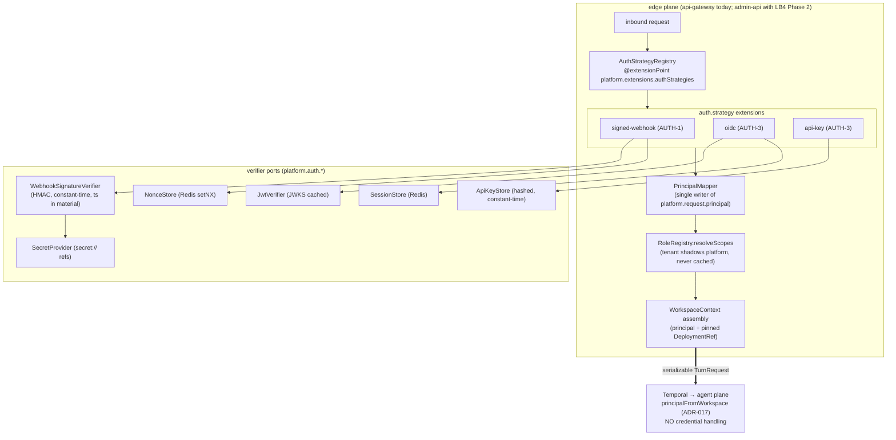
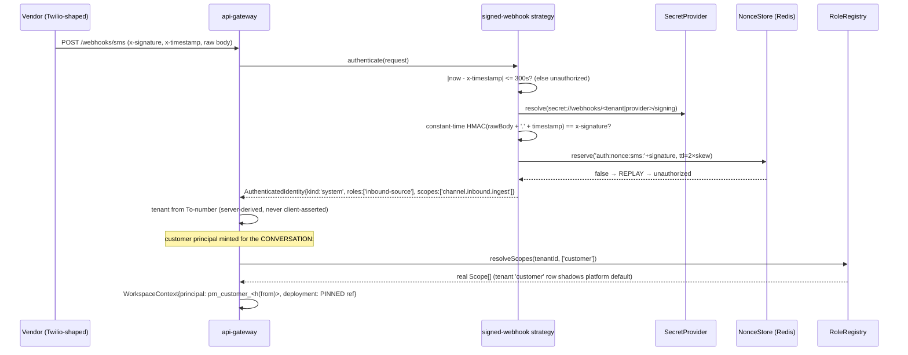

# Edge Authentication Design

**Status:** implemented through AUTH-3 bearer (2026-07-15). The "Current reality" table below is the
pre-build snapshot of 2026-07-14 this design was written against.

**Original status:** DESIGN — reviewed before build (user-decided 2026-07-14: paper first).
**Grounds:** the edge-authn substrate (authentication strategies), role→scope resolution (role matrix),
`SecretRef`/`SecretProvider` (S1), the threat cases `forged-webhook` and `replayed-side-effect-request`,
`contracts/tenant.ts` (`Principal`), and ADR-017/019/022.

# Purpose

Turn the security requirements into a concrete, phased authn design for hermes-one — closing the three
gaps identified in the production-readiness review: (a) the webhook edge authenticates only the vendor HMAC with a single
shared secret and no replay guard; (b) no human/API caller can authenticate at all (no admin surface);
(c) the live agent-turn principal and scopes are demo literals (`prn_demo`, hardcoded scope list) in
`apps/workflow-worker/src/turn-request.ts`.

Authentication answers **"who is calling, and for which tenant"** (authentication strategies). It is
strictly upstream of authorization: strategies produce a `Principal`; the ALREADY-BUILT machinery
downstream (scope-gated tool derivation via `capabilitiesForEngine`, ADR-019 policy pre/post gates) is
real and tested. This design supplies the identity that machinery consumes, and changes nothing
downstream of it. **No authentication strategy ever runs in the agent plane** (ADR-017); the turn
receives its principal value-mapped through the serializable `WorkspaceContext`.

# Scope

**In scope:** the channel-webhook edge posture (hardening the existing live path); the admin-api authn
substrate (designed now, built with the LB4 REST surface — ledger L3); principal/scope assembly at the
ingest edge (replacing the demo literals); role→scope resolution over `tenant.roles`; the `SecretRef`
seam replacing env-only secrets (S1 path); the confirm-token lifecycle under multi-instance workers.

**Out of scope:** the authorization decision itself (policy voters/gates — built, Tier 1.2); PII
field encryption (encrypted-field registry); SAML; the ABAC attribute catalog beyond what
`Principal.attributes` already carries.

# Current reality → target gap

| Area                   | Today (verified in code)                                                                                                                                    | Target                                                                                                                                                   |
| ---------------------- | ----------------------------------------------------------------------------------------------------------------------------------------------------------- | -------------------------------------------------------------------------------------------------------------------------------------------------------- |
| Webhook authn          | HMAC-SHA256 over raw body, `timingSafeEqual` (`sms-transport.ts`) — but ONE shared secret, no timestamp in signed material, no skew window, no replay guard | `signed-webhook` strategy: constant-time HMAC over raw body **+ timestamp**, bounded skew, Redis `NonceStore` replay guard, per-provider `secret://` ref |
| Tenant binding         | `tenantByNumber` demo map (To-number → tenant)                                                                                                              | server-derived DID/number registry (tenant registry, CT2) — the _derivation direction_ is already correct (never client-asserted)                        |
| Human/API authn        | none (no admin surface)                                                                                                                                     | `oidc` (humans, sessions) + `api-key` (service accounts) strategies on the LB4 REST sequence                                                             |
| Principal on live path | `prn_demo` + hardcoded `scopes` in `turn-request.ts`                                                                                                        | principal minted at ingest; scopes resolved per-request from roles (`RoleRegistry.resolveScopes`)                                                        |
| Role→scope             | none (CT2: `tenant.{users,roles}` tables exist, no repos)                                                                                                   | `RoleRegistry` over `tenant.roles`, tenant row shadows platform row of the same name, never cached                                                       |
| Secrets                | `StaticProviderCredentialStore` env-backed, tenant-agnostic (S1 🔴)                                                                                         | `SecretRef` grammar (`secret://<store>/<path>`) + `SecretProvider` port; per-(tenant, provider) resolution                                               |
| Confirm tokens         | agentback in-memory `ConfirmationStore` (spike) — breaks multi-instance                                                                                     | shared store; token fingerprint-bound to the exact input (threat `replayed-side-effect-request`)                                                         |

# Architecture



The `agent` principal kind is never produced by a strategy — it is value-mapped inside the turn from
the already-authenticated principal (ADR-017). Auth strength (`single|mfa|step-up|api-key|workload`)
rides on the identity as a carried fact; policy pre-gates consume it for step-up (this layer signals,
never enforces).

# Sequence — the hardened webhook ingest (AUTH-1 target state)



Two principals are deliberate (per the authentication-strategies examples): the **webhook source**
authenticates as `kind:'system'` scoped to ingest only; the **customer** the conversation acts _for_
is a `kind:'user'` principal minted from the inbound handle with roles `['customer']` — its scopes are
what gate the agent's tools. The pre-design demo literals conflated the two into `prn_demo`.

# TypeScript interfaces (what gets transcribed where)

Verbatim transcriptions when built (no new invention):

- `@hermes-one/contracts/src/role.ts` — `RoleId`, `RoleDefinition` (mirrors `tenant.roles`
  column-for-column), `RoleCreateInput`/`RoleUpdateInput`, `RoleRegistry` port
  (role matrix; new in this design).
- `@hermes-one/contracts/src/auth.ts` — `AuthMethod`, `AuthStrength`, `SessionMeta`,
  `AuthenticatedIdentity`, `VerifiedClaims`, `ApiKeyRecord`, `WorkloadClaims`, `StoredSession`
  (authentication strategies). The `AuthStrategy` interface itself lives in the auth
  component (it references `@loopback/rest`'s `Request` — contracts stay container-free, same split
  as `PlatformBindings`).
- `@hermes-one/contracts/src/secret.ts` — `SecretRef` grammar
  (`^secret:\/\/[a-z0-9][a-z0-9._-]*(\/[a-z0-9][a-z0-9._-]*)+$`) + `SecretProvider` port
  (secrets and key management).
- `@hermes-one/auth` (NEW edge component, `components/auth`) — `AuthStrategyRegistry`
  (`@extensionPoint('platform.extensions.authStrategies')`, extension type `auth.strategy`,
  first-match-by-`applies()`, fail-closed when none), `PrincipalMapper` (the single writer of
  `platform.request.principal`), the strategy providers, `toUserProfile` LB4 adapter.
- Verifier ports (`platform.auth.*` keys): `WebhookSignatureVerifier`, `NonceStore`, `JwtVerifier`,
  `ApiKeyStore`, `SessionStore` — Redis-backed impls extend `@hermes-one/redis`
  (`NonceStore.reserve` = `SET NX EX`; the `RedisClient` port gains `setnx`).

# Key design decisions

1. **Evolve, don't fork, the webhook path.** `SmsChannelTransport.ingest`'s HMAC verify is already
   constant-time over the raw body — AUTH-1 adds the timestamp into the signed material
   (`HMAC(rawBody + '.' + timestamp)`), the 300s skew window, and the `NonceStore` replay guard, and
   swaps the inline `signingSecret` for a `SecretRef` resolved through `SecretProvider`. The strategy
   _shape_ (`applies()`/`authenticate()`) wraps this when the auth component lands; the verify logic
   is shared, not duplicated. **Breaking change flag:** adding the timestamp to the signed material
   changes the signature the test-double/e2e vendors compute — one coordinated change, covered by itests.
2. **Roles are the source; scopes are derived per request, never stored or cached**
   (role matrix `resolveScopes`: never cached; no table stores
   `Principal.scopes` — a role edit must take effect on the next request).
3. **Scope assembly happens at the EDGE (ingestor), not in the workflow.** The workflow sandbox
   cannot do I/O; `buildAgentTurnRequest` stays pure. The ingestor resolves scopes + mints the
   customer principal into `WorkspaceContext` alongside the deployment pin it already writes (D1
   pattern) — `WorkflowRunRef` carries the principal, the workflow threads it through.
4. **`SecretProvider` is the S1 exit.** `StaticProviderCredentialStore` becomes an env-backed
   `SecretProvider` (`secret://env/<name>` in dev); the KMS/cloud-secret-manager impl swaps in behind
   the same port. Webhook signing secrets and vendor SMS creds resolve per `(tenantId, providerId)`.
5. **Admin-api authn is DESIGNED here, BUILT with LB4 Phase 2** (the REST surface, ledger L3). MVP
   strategies: `oidc` (humans; JWKS-verified; Redis sessions; issuer/audience/claims from
   `platform.auth.config`) + `api-key` (service accounts; sha-256-hashed lookup, constant-time).
   `oauth2` and `service-identity` (mTLS/SPIFFE) are documented later phases. Strategy order:
   `signed-webhook → api-key → oidc` (cheap-shape first; per the `strategyOrder` config).
6. **Confirm tokens move to Redis.** The agentback `ConfirmationStore` is in-memory (spike finding);
   under multi-instance agent-workers a confirm issued by one instance must be redeemable on another.
   A Redis-backed store keyed by token with input-fingerprint binding (threat
   `replayed-side-effect-request`: a replayed confirm with a mismatched fingerprint is rejected) and
   a short TTL. Depends on agentback exposing the store as an injectable seam — verify against 0.7.1;
   if it is not injectable, flag upstream (library-vs-design gap, do not fork).

# Configuration

`platform.auth.config` (frozen after boot; secrets only as `secret://` refs):

```json
{
  "strategyOrder": ["signed-webhook", "api-key", "oidc"],
  "signedWebhook": {
    "signatureHeader": "x-signature",
    "timestampHeader": "x-timestamp",
    "skewWindowSeconds": 300,
    "algo": "hmac-sha256",
    "replayGuard": true,
    "secretRef": "secret://env/SMS_WEBHOOK_SIGNING"
  },
  "oidc": {
    "issuers": [
      {
        "issuer": "https://login.example/",
        "jwksRef": "secret://oidc/platform/jwks",
        "audience": "platform-admin",
        "tenantClaim": "https://platform/tenant_id",
        "rolesClaim": "https://platform/roles",
        "jwksCacheTtlSeconds": 900
      }
    ]
  },
  "apiKey": {"header": "x-api-key", "hashAlgo": "sha-256"},
  "session": {
    "cookieName": "sid",
    "ttlSeconds": 28800,
    "idleTimeoutSeconds": 3600
  },
  "stepUp": {"maxAgeSeconds": 300, "requiredStrengthForSensitive": "step-up"}
}
```

# Build plan (phased, each independently green)

| Phase      | Scope                                                                                                                                                                                                                                                                       | Depends on                                                                                                                       |
| ---------- | --------------------------------------------------------------------------------------------------------------------------------------------------------------------------------------------------------------------------------------------------------------------------- | -------------------------------------------------------------------------------------------------------------------------------- |
| **AUTH-1** | Webhook hardening: timestamp-in-material + skew window + `NonceStore` replay guard + `SecretRef`/`SecretProvider` seam (env-backed impl). Itests: forged sig, stale timestamp, replayed signature, rotated secret.                                                          | nothing — buildable now                                                                                                          |
| **AUTH-2** | `contracts/{role,auth,secret}.ts` transcribed; `RoleRegistry` over `tenant.roles` (repo + seed of the platform-default role matrix); principal minting + `resolveScopes` at the ingestor; `turn-request.ts` demo literals DELETED (principal arrives via `WorkflowRunRef`). | **CT1 🔴** (tenant-id type) for the `tenant.users` join; the roles path alone only needs `tenant.roles` (text-keyed, usable now) |
| **AUTH-3** | `components/auth`: `AuthStrategyRegistry` + `PrincipalMapper` + `oidc`/`api-key` strategies + Redis `SessionStore`; wired into the LB4 REST sequence.                                                                                                                       | LB4 Phase 2 (RestApplication + sequence, ledger L3)                                                                              |
| **AUTH-4** | Redis `ConfirmationStore` (multi-instance confirm) + step-up enforcement as a policy pre-gate consuming `authStrength`.                                                                                                                                                     | agentback store-injection seam verified                                                                                          |

# Testing strategy

| Test                          | Asserts                                                                                                                      |
| ----------------------------- | ---------------------------------------------------------------------------------------------------------------------------- |
| forged webhook (itest)        | wrong signature → 401, no workflow started, nothing persisted                                                                |
| stale timestamp (unit)        | `                                                                                                                            | now-ts | > skew` → 401 before any HMAC work |
| replay (itest)                | identical valid request twice → first 200, second 401 (NonceStore), no duplicate workflow                                    |
| secret rotation (itest)       | old ref → 401 after rotation; new ref verifies                                                                               |
| role shadowing (itest)        | tenant `customer` row shadows platform default; `resolveScopes` returns the tenant's set                                     |
| role-edit freshness (itest)   | scope removed from role → next request's principal lacks it (no cache)                                                       |
| scope-gate integration (e2e)  | customer principal WITHOUT `appointment.slot.read` → the tool is not derived; turn cannot call it                            |
| principal isolation (unit)    | webhook `system` principal carries ONLY `channel.inbound.ingest` — it can never reach the agent turn as the acting principal |
| unauthorized redaction (unit) | 401 body carries no claim/schema detail (no leakage)                                                                         |

# Acceptance criteria

1. A forged, stale, or replayed webhook is rejected 401 before any repository or Temporal call.
2. No demo principal literals remain: the live turn's `Principal` (id/kind/roles/scopes) is minted at
   the edge and its scopes come from `RoleRegistry.resolveScopes` per request.
3. The webhook source principal (`kind:'system'`) and the acting customer principal (`kind:'user'`)
   are distinct; the system principal's scopes never gate agent tools.
4. All signing/verification secrets resolve through `SecretProvider` via `secret://` refs; no secret
   string reaches a definition body, prompt, log, or the config object at rest.
5. `platform.request.principal` has exactly one writer (`PrincipalMapper`).
6. Strategies are fail-closed: present-but-invalid credential → `unauthorized`; no applicable
   strategy → `unauthorized`; a request with no derivable tenant → `tenant_not_resolved`.

# Open Questions

- **CT1 (🔴, gating AUTH-2's user join):** `tenant.tenants`/`tenant.users` PK type (uuid) vs the text
  `tnt_`/`prn_` brand the whole system keys on. **Recommendation: text branded ids everywhere**
  (migrate the two uuid columns) — every GUC, RLS policy, contract, and existing row already speaks
  the brand; uuid buys nothing here. Needs sign-off as it contradicts the repository-patterns
  column type.
- **API-key storage:** `ApiKeyRecord` needs a table (hashed key, tenant, principal, scopes, status,
  expiry). Candidates: a `tenant.api_keys` table (new catalog row — needs a table-catalog amendment)
  vs overloading `tenant.users.attributes`. Recommendation: a real table, amended into the catalog —
  overloading attributes hides a credential store from RLS review.
- **OIDC IdP:** config-driven issuer list; which IdP the first deployment uses is an ops
  decision, not a code one.
- **Platform-admin cross-tenant posture:** the role matrix defines `platform-admin` with cross-tenant
  scopes, but the RLS relay-role question (the row-level-security open question — same tension as the
  outbox publisher) is still unresolved upstream. Admin cross-tenant reads stay blocked on it.
- **DID/number → tenant registry:** stays the demo map until the tenant registry lands (CT2); the
  registry table (`tenant.workspaces` or a new `tenant.numbers`) needs a catalog decision.
- **agentback `ConfirmationStore` injectability** (AUTH-4): verify against 0.7.1; flag upstream if
  the store is not a replaceable seam.

# Future Extensions

- `oauth2` (partner developers, delegated) and `service-identity` (mTLS/SPIFFE/workload OIDC)
  strategies; SAML.
- Step-up flows in admin-web (fresh re-auth for sensitive actions; `amr`-driven `mfa` strength).
- Per-tenant OIDC issuers (tenant-supplied IdP) via the same issuer-list config grammar.
- Key-rotation automation for webhook signing secrets (dual-secret verify window during rotation).
