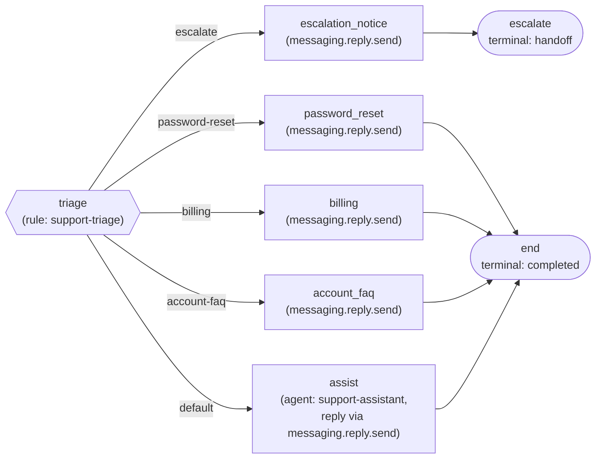

# Support-ticket triage vertical

This is a second vertical, written entirely as data (ADR-013, "verticals are data"), for inbound
customer support on a software product. It installs the same way the electrician vertical does,
with `installVerticalPack(pgUrl, redisUrl, tenantId, 'verticals/support/pack.json')` or the admin
API's `PUT /v1/definitions/{id}` and `POST /v1/deployments`. It runs on the same workflow
interpreter, rule runtime, and policy runtime. The platform has no support-specific code.

The pack shows the platform's main routing idea: deterministic rules handle most messages, and the
model is called only for a message that needs judgment.

## The bundle (`pack.json`)

| Family       | Name                   | What it does                                                                                                 |
| ------------ | ---------------------- | ------------------------------------------------------------------------------------------------------------ |
| workflow     | `support-intake`       | Triage an inbound message, then reply by template, escalate, or hand to the support agent.                   |
| rule         | `support-triage`       | Classifies the message `text` into a routing outcome (case-insensitive keyword match).                       |
| policy       | `support-reply-safety` | Post-gate on the agent's draft reply. A reply that asks for a password is flagged for repair.                |
| capability   | `messaging.reply.send` | Send a reply to the customer on their channel: templated replies and the agent's reply.                      |
| agent-engine | `support-assistant`    | Polite, concise support persona with no tools. `model` is left empty, so the worker's configured model runs. |

## Workflow graph

The rule node reads one fact, `text`, bound from the channel-neutral run input (`{"$input": "text"}`).

## Triage outcomes

Branches are evaluated in order and the first match wins. Every term is matched with
`contains(lower(text), term)`, so matching is case-insensitive.

| Order | Outcome          | Terms                                                                                                 | Route                                         |
| ----- | ---------------- | ----------------------------------------------------------------------------------------------------- | --------------------------------------------- |
| 1     | `escalate`       | `outage`, `is down`, `breach`, `hacked`, `compromised`, `unauthorized`, `security incident`, `urgent` | Templated notice, then the `handoff` terminal |
| 2     | `password-reset` | `password`, `locked out`, `can't log in`, `cannot log in`, `can't sign in`, `cannot sign in`          | Templated reply                               |
| 3     | `billing`        | `invoice`, `receipt`, `billing`, `payment method`                                                     | Templated reply                               |
| 4     | `account-faq`    | `change my email`, `update my email`, `update my profile`, `two-factor`, `2fa`, `export my data`      | Templated reply                               |
| last  | `needs-judgment` | (default: no term matched, including a message with no text)                                          | Bounded agent turn                            |

Escalation comes first. A message that reports an outage or security issue along with a simple
request ("someone hacked my account and changed my password") gets escalated. It doesn't get a
templated answer.

## How escalation is realized

Escalation is deterministic. The `escalate` outcome routes to a capability node that sends the
customer a templated notice. From there it goes to a terminal node with `outcome: "handoff"` and
`result: {"queue": "urgent", "reason": "outage-or-security-report"}`. The workflow run ends with the
`handoff` outcome and never calls the model. Every rule decision, escalations included, is recorded
as a `decision.rule` audit event.

The agent engine has no tools (`allowedCapabilities: []`). It answers in its composed reply, which
passes through the `support-reply-safety` post-gate.

## How the agent's reply is delivered

The `assist` node declares `deliverReply`. When the turn ends with the `replied` outcome, the
workflow sends the turn's final, post-gated reply through `messaging.reply.send` (template
`support_agent_reply`, body bound with `{"$agent": "reply"}`, recipient bound with
`{"$input": "from"}`). That's the same capability path the templated replies use.

A reply the post-gate flags for repair is never sent unrepaired. The turn composes again once and
goes back through the gate. The agent worker's default evidence-only composer can't reshape the
draft, so a turn like that hands off. A turn that hands off sends nothing.

## Verification

- `apps/workflow-worker/src/support-pack-rule.spec.ts` (unit): the triage rule routes each intent
  class as designed, mixed case included. Escalation wins over a simple intent. The compiled workflow
  walks the templated (password reset), escalation, and agent routes with the expected path, and the
  deterministic routes run no agent turn. The agent route delivers the turn's reply, and a handoff
  delivers nothing.
- `apps/admin-api/src/support-pack.itest.ts` (integration): installs the pack through the admin API
  and checks that the active deployment rebuilds with the support pack's members.
- `apps/agent-worker/src/support-pack.e2e.ts` (end-to-end; CI runs it against the mock model, or point it
  at a real one): one run per routing class on real Temporal. Each run is checked against the durable audit timeline and one
  outbound `runtime.messages` row.

## What's still open for this vertical

Tracked in [`../../docs/DEFERRED-AND-FLAGGED.md`](../../docs/DEFERRED-AND-FLAGGED.md) (SP1–SP3):

- SP1: a workflow `handoff` terminal ends the run with the `handoff` outcome, but it doesn't write a
  `runtime.handoff_tasks` row. Today only an agent turn's handoff outcome saves one.
- SP2: reply bodies are written inline on the capability nodes. The `template` field is just an
  identifier, and no tenant template catalog resolves it yet (CT6). There's no ticket-system
  capability, so the pack doesn't open or update tickets.
- SP3: the support agent can't ask for a human on its own. The triage rule decides escalation before
  the agent node runs.
